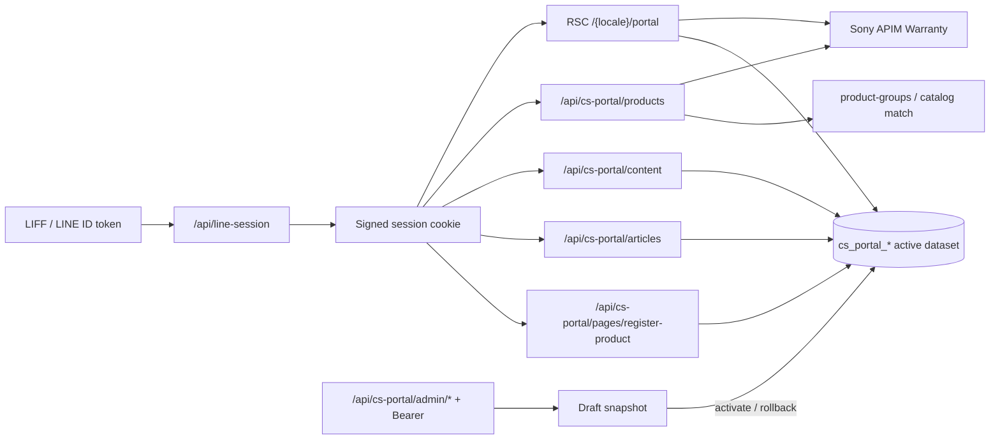

# Technical Document

ขอบเขต: **CS Portal (CSR Portal / Product Center)** เท่านั้น — ไม่ครอบคลุม Digital Badge shelf / mission ยกเว้นจุดที่แชร์ session, Sony APIM และ deploy runtime เดียวกัน

## BE

### Configuration, Service and Maintenance

**Runtime**

- Next.js 14 App Router (Node.js) บน Azure App Service Windows (`server.js` + `web.config` / iisnode)
- ใช้ MySQL เดียวกันกับ Badge; ตาราง Portal แยกและไม่แก้ข้อมูล Badge เมื่อ activate/rollback dataset

**Environment variables (ชื่อเท่านั้น — ห้ามใส่ค่าจริง)**

| กลุ่ม | ชื่อตัวแปร | หมายเหตุ CS Portal |
|---|---|---|
| App / DB | `APP_ENV`, `APP_BASE_URL`, `DATABASE_URL`, `DATABASE_SSL` | `APP_ENV` = `local` \| `staging` \| `production` (ไม่ใช้ค่า `uat`) |
| Session / LINE | `LINE_CHANNEL_ID`, `LINE_VERIFY_ID_TOKEN_URL`, `APP_SESSION_SECRET`, `LOG_HASH_SECRET` | ตรวจ LIFF ID token → cookie session |
| Badge LIFF (แชร์) | `NEXT_PUBLIC_LIFF_ID` | channel หลักของแอป |
| Portal LIFF | `NEXT_PUBLIC_CSR_PORTAL_LIFF_ID` | fallback; ค่าจริงอาจมาจาก `app_config.cs_portal_liff_id` |
| Sony ownership | `SONY_PRODUCT_API_MODE`, `SONY_PRODUCT_API_BASE_URL`, `SONY_PRODUCT_API_SUBSCRIPTION_KEY`, `SONY_PRODUCT_API_COUNTRY_CODE` | live = APIM warranty by LINE |
| Register / account CTA | `NEXT_PUBLIC_REGISTER_PRODUCT_URL`, `NEXT_PUBLIC_ACCOUNT_URL` | fallback เมื่อ CMS ไม่มีลิงก์ |
| Admin | `CS_PORTAL_ADMIN_TOKEN` | Bearer สำหรับ `/api/cs-portal/admin/*` เท่านั้น; ไม่ใช่ LINE cookie / session secret |

**Dependencies**

- MySQL: `cs_portal_products`, `cs_portal_contents` + pointer ใน `app_config`
- Sony APIM `QueryWarrantyMySonyByLine` (ownership / warranty)
- LINE Login verify ID token (`/api/line-session`)
- ไม่มี queue/cache แยก; content อ่านจาก active dataset version ใน DB (Portal LIFF ID มี in-process cache ~60s)

**Health / logging / maintenance**

- Health: `GET /api/health` → `{ status: "ok", runtime: "nodejs" }`
- Smoke static: `/deployment-check.html`
- Logging: ใช้ `LOG_HASH_SECRET` (หรือ fallback `APP_SESSION_SECRET`) สำหรับ hash identifier — ห้าม log LINE UUID ดิบในข้อความ error ที่ปลอดภัยแล้ว
- Schema check/apply: `npm run db:cs-portal:migrate` / `npm run db:cs-portal:migrate:apply`
- Verify pointers/schema: `npm run db:cs-portal:verify`
- Dataset CLI: `npm run db:cs-portal:dataset -- <preview|status|apply|activate|verify>` (ดู `scripts/db/cs-portal/dataset-cli.mjs`; ต้องระบุ `--expected-host` / `--expected-database` สำหรับคำสั่งที่แตะ DB)
- Import engine tests: `npm run test:cs-portal-import`
- Rollback เนื้อหา: ผ่าน Admin API `POST /api/cs-portal/admin/rollback` (CLI ไม่มีคำสั่ง rollback แยก — ใช้ `activate` ชี้ hash เก่าได้ด้วย CAS เดียวกัน)

**app_config keys ที่เกี่ยวกับ Portal**

- `cs_portal_schema_version` (ปัจจุบัน schema module = `"1"`)
- `cs_portal_active_dataset_version`
- `cs_portal_draft_dataset_version`
- `cs_portal_revision` (CAS / optimistic concurrency — decimal string)
- `cs_portal_liff_id` (optional override ของ Portal LIFF)
- `cs_portal_dataset:<hash>` (marker สำหรับ empty snapshot)

### System Logic & Architecture

**หน้าที่หลัก**

1. ยืนยันตัวตนผ่าน LIFF → `/api/line-session` ได้ signed cookie
2. ดึงสินค้าที่ลงทะเบียนจาก Sony ตาม `lineuuid`
3. จับคู่กับ catalog/CMS dataset ที่ active ใน MySQL (model key, category, CTA, carousel, articles, footer, register page)
4. แสดง Product Center (home) และหน้า Register Product; รองรับสถานะ not_linked / no_products / error

**Production home path**

- หน้า `/{locale}/portal` เป็น RSC (`portal/page.tsx`): โหลด session → Sony products → catalog/content enrichment ฝั่งเซิร์ฟเวอร์ → `toProductCards`
- Catalog/CMS enrichment เป็น **best-effort**: ถ้า DB/tunnel ล้ม ownership จาก Sony ยังแสดงได้; enrichment ว่างแทน fail ทั้งหน้า
- แสดงเฉพาะ model ที่ match catalog ใน active dataset (`matchedCatalog`)
- `home-contract.ts` ยังเป็น pure helper สำหรับ batch content (≤ 50 model/request) และ composition ใน API/test flow — ไม่ใช่ entrypoint ของ RSC home ปัจจุบัน

**โมดูลหลัก**

| ชั้น | path |
|---|---|
| Public API | `src/app/api/cs-portal/{products,content,articles,pages/register-product}/route.ts` |
| Admin API | `src/app/api/cs-portal/admin/[...path]/route.ts` |
| Domain | `src/lib/cs-portal/*` (products, product-groups, cta/carousel/articles, home-contract, admin-*, portal-liff-id, portal-product-cards) |
| Content load | `src/lib/cs-portal/content-repository.ts` |
| Shared Sony / session | `src/lib/sony-products-client.ts`, `src/lib/sony-account.ts`, `src/lib/auth-session.ts` |
| Schema / import | `scripts/db/cs-portal/{schema,migrate,dataset,repository,dataset-cli}.mjs` |

**Public API (ต้องมี LINE session cookie)**

| Method | Path | พฤติกรรมหลัก |
|---|---|---|
| GET | `/api/cs-portal/products` | ownership + `productGroups`; ไม่รับ query; 401 / 502 / 500 ตาม error |
| GET | `/api/cs-portal/content?locale=&model=` | CTA / carousel / footer ตาม active dataset (batch model ≤ 50 ต่อ request ใน home-contract) |
| GET | `/api/cs-portal/articles?locale=&modelKey=&actionKey=` | รายการ articles ของ CTA type `articles` |
| GET | `/api/cs-portal/pages/register-product?locale=th\|en` | CMS page blocks; 404 ถ้า locale ไม่มีข้อมูล |

**Account / product states (`getPortalProducts`)**

| Sony outcome | `accountStatus` | `productState` | HTTP (products API) |
|---|---|---|---|
| พบลูกค้า มีสินค้า | `linked` | `has_products` | 200 |
| พบลูกค้า ไม่มีสินค้า / business empty | `linked` | `no_products` | 200 + `emptyState` |
| ไม่พบ LINE UUID | `not_linked` | `not_applicable` | 200 + `placeholder` (ซ่อน footer ฝั่ง FE) |
| upstream / timeout | — | — | 502 `SONY_PRODUCTS_UNAVAILABLE` |
| ไม่มี session | — | — | 401 |

**Dataset versioning**

- เนื้อหา immutable ต่อ `dataset_version` (hash 64 ตัวอักษร)
- แก้ไขผ่าน Admin/CLI → สร้าง draft snapshot ใหม่; active เปลี่ยนเฉพาะตอน `activate` / `rollback`
- ทุก write ต้องส่ง `revision` ปัจจุบัน; ชนกัน → 409
- Activate/rollback ไม่แก้แถว Badge และไม่แทนที่ draft โดยอัตโนมัติเมื่อ activate
- Admin body limit 8 MiB; dataset สูงสุด ~10,000 products / ~20,000 contents (ตาม validator)



### Deployment step/Rollback guide

CS Portal อยู่ในแพ็กเกจ Next.js เดียวกับ Badge — deploy ตาม branch เดิม

**Deploy prerequisites**

1. Schema Portal ถูก apply บน DB เป้าหมายแล้ว (`npm run db:cs-portal:migrate:apply` จาก host ที่เข้าถึง Azure MySQL ได้ — workflow ไม่รัน migrate)
2. มี active dataset ที่ validate แล้ว (CLI หรือ Admin import → activate)
3. Secrets ใน GitHub Environment: `UAT_ENV_FILE` / `PROD_ENV_FILE` รวมตัวแปรร่วม + (ถ้าใช้) `CS_PORTAL_ADMIN_TOKEN`, `NEXT_PUBLIC_CSR_PORTAL_LIFF_ID`
4. ตั้ง `cs_portal_liff_id` ใน `app_config` หากต้องการ override LIFF ของ Portal โดยไม่ rebuild

**Deploy steps (แอป)**

1. Merge เข้า branch `uat` → deploy UAT (`mysonybadgestg` / `https://stglineminiapp.sony.co.th`)
2. หลังยืนยัน UAT แล้ว: merge เข้า branch `main` → deploy production (`mysonybadgesprd` / `https://lineminiapp.sony.co.th`)

**Content / dataset (แยกจาก code deploy)**

1. Backup pointers + ตาราง Portal ตาม `docs/backup-rollback-plan.html` / dump `cs_portal_*`
2. CLI `preview` → `apply` (หรือ Admin `import/preview` → `import/apply`) → ตรวจ draft
3. `activate` ด้วย revision ล่าสุด
4. ยืนยัน home/register กับ locale ที่ต้องการ

**Rollback**

| ชั้น | วิธี |
|---|---|
| App binary | ไม่มี job rollback ใน Actions — redeploy SHA เก่า (`workflow_dispatch` หรือ Redeploy ใน Azure) |
| Dataset เนื้อหา | Admin `POST .../rollback` (หรือ CLI/activate ชี้ hash เก่า) + revision ปัจจุบัน |
| Seed/script ล้มกลางทาง | transaction ใน repository rollback การเขียนรอบนั้น |
| Schema | ไม่มี auto schema rollback — ต้องแผน DDL ย้อนเอง; ห้าม `db:reset` บน UAT/prod |

**Verify หลัง deploy / rollback**

- `GET /api/health`
- เปิด `/{locale}/portal` ใน LINE (LIFF ที่ถูกต้อง)
- กรณีมีสินค้า / ไม่มีสินค้า / not_linked
- Register: `/{locale}/portal/register` และ/หรือ API register-product ตาม locale
- ถ้าเพิ่ง activate dataset: เทียบ `cs_portal_active_dataset_version` กับ hash ที่ตั้งใจ

### Code scanning report(Optional)

- Lint: `npm run lint` (ESLint / `eslint-config-next`) — รันใน CI ก่อน build
- Unit/integration: `npm test` (Vitest) รวม `src/lib/cs-portal/**/*.test.ts`, `src/app/api/cs-portal/**/*.test.ts`
- Import engine: `npm run test:cs-portal-import`
- ไม่มีรายงาน SAST/DAST เฉพาะ CS Portal ใน repo; ผล lint/test อยู่ใน GitHub Actions log ของ workflow UAT/PROD
- เอกสารรีวิว BE ราย API อยู่ที่ `docs/cs-portal/*-review-2026-09-18.md`

### Load testing(Optional)

N/A — ไม่มีสคริปต์/รายงาน load test สำหรับ CS Portal ใน repository นี้  
(ถ้าต้องทำภายหลัง: เป้าที่แนะนำคือ RSC home / `GET /api/cs-portal/products` + batched `content` ภายใต้ session จริง/จำลอง และเคส 51+ model keys ตาม home-contract)

### Source code

```text
src/app/api/cs-portal/          # public + admin API routes
src/lib/cs-portal/              # domain logic, repositories, contracts
scripts/db/cs-portal/           # schema, migrate, dataset validate/import, fixtures
docs/cs-portal/                 # API/UAT review notes
```

Entrypoints สำคัญ: `products.ts`, `content-repository.ts`, `admin-handler.ts`, `home-contract.ts`, `portal-product-cards.ts`, `portal-liff-id.ts`, `scripts/db/cs-portal/repository.mjs`

### API Doc(Swagger/postman)(Optional)

N/A — ไม่มี OpenAPI/Swagger หรือ Postman collection ที่ commit สำหรับ CS Portal  
สัญญา API อ้างอิงจาก:

- โค้ด route + Vitest (`src/app/api/cs-portal/**`)
- รีวิวใน `docs/cs-portal/` (products, content/carousel, articles, CTA, register-product, admin, home)
- ตัวอย่าง JSON: `docs/cs-portal/register-product-th-response.json`, `docs/cs-portal/carousel-uat-empty-response-2026-09-18.json`

Admin path สรุป (ทุกเส้นต้อง `Authorization: Bearer <CS_PORTAL_ADMIN_TOKEN>`):

- `GET /api/cs-portal/admin/state`, `GET .../versions`
- CRUD `.../products`, `.../contents`
- `POST .../import/preview`, `POST .../import/apply`
- `POST .../activate`, `POST .../rollback`

## FE

### Environmental available

| Environment | APP_ENV | App base (known) | หมายเหตุ Portal |
|---|---|---|---|
| Local | `local` | `http://localhost:3000` | mock Sony ได้; LIFF optional |
| UAT / staging | `staging` | `https://stglineminiapp.sony.co.th` | App Service `mysonybadgestg` |
| Production | `production` | `https://lineminiapp.sony.co.th` | App Service `mysonybadgesprd` |

**FE-related env (ชื่อเท่านั้น)**

- `NEXT_PUBLIC_APP_BASE_URL`
- `NEXT_PUBLIC_LIFF_ID` (Badge / shared channel)
- `NEXT_PUBLIC_CSR_PORTAL_LIFF_ID` (Portal channel fallback)
- `NEXT_PUBLIC_REGISTER_PRODUCT_URL`, `NEXT_PUBLIC_ACCOUNT_URL`
- `NEXT_PUBLIC_DEBUG_MOCK_JSON` (ต้องเป็น `false` ตอน deploy)

Locale ที่รองรับ: `th`, `en` (middleware + i18n dictionary `portal`)

### Access (Link/LIFF for user access)

**In-app routes**

- Home Product Center: `/{locale}/portal` (เช่น `/th/portal`, `/en/portal`)
- Register Product UI: `/{locale}/portal/register`
- Prototype (local/dev; 404 เมื่อ `NODE_ENV=production`): `/{locale}/prototype/cs-portal`

**LIFF**

- Layout `(csr_portal)` ใช้ `resolvePortalLiffId()` → `app_config.cs_portal_liff_id` ก่อน แล้วค่อย `NEXT_PUBLIC_CSR_PORTAL_LIFF_ID`
- Channel จาก Portal LIFF ถูก merge เข้า `lineChannelIds` สำหรับ verify ID token
- ผู้ใช้ต้องเปิดผ่าน LINE LIFF ที่ผูก endpoint ไปยัง origin ของ environment นั้น

**Auth prerequisites สำหรับ tester**

1. บัญชี LINE ที่อยู่ใน LIFF ของ Portal
2. (กรณี linked) บัญชี My Sony ที่ผูก LINE และมี/ไม่มีสินค้าตามเคสทดสอบ
3. Session cookie หลัง `/api/line-session` สำเร็จ — ห้ามส่ง `lineuuid` ใน query สำหรับ staging/production

ค่า LIFF ID จริงต่อ environment อยู่ใน secret/env ของทีม — ไม่บันทึกในเอกสารนี้

### Deployment step

CS Portal FE ถูก build รวมใน `npm run build` ของแอปเดียวกัน

1. ใส่ `NEXT_PUBLIC_*` ที่ถูกต้องใน `UAT_ENV_FILE` / `PROD_ENV_FILE` ก่อน build (ค่า public ฝังตอน build)
2. Push branch → CI: `config:check` → test → lint → build → แพ็ก `.next` + `public` + `server.js` + `web.config`
3. Deploy App Service ตาม workflow UAT/PROD
4. Post-deploy smoke:
   - เปิด LIFF → หน้า `/{locale}/portal`
   - ตรวจ header profile, product cards / empty / not_linked
   - เปิด bottom sheet articles / external CTA
   - เปิด register page และลิงก์ CTA ออกนอกแอป
   - สลับภาษา `th` / `en`

### Code scanning report(Optional)

- ชุดเดียวกับ BE: `npm run lint`, `npm test` ครอบคลุม components/lib ที่ Portal ใช้
- ไม่มีรายงาน visual regression / E2E browser ที่ commit สำหรับ Portal
- Prototype README: `src/app/[locale]/(csr_portal)/prototype/cs-portal/README.md`

### Source code

```text
src/app/[locale]/(csr_portal)/
  layout.tsx                 # LineSessionProvider + Portal LIFF
  portal/page.tsx            # Product Center (RSC)
  portal/register/page.tsx   # Register Product (RSC)
  portal-layout.css
  prototype/cs-portal/       # interactive prototype / mock engine
src/components/portal/       # UI: cards, footer, sheets, session, empty/not-linked
src/lib/cs-portal/           # mapping cards, CTA visibility, dates, copy helpers
src/lib/i18n/messages/{th,en}.ts  # messages.portal.*
```

### Error Handling & Retry Flow

**User-facing states (home)**

| สถานะ | UI | พฤติกรรม |
|---|---|---|
| กำลังรอ session | `PortalSignedOut` + skeleton | `PortalSessionRefresh` reload หนึ่งครั้งหลัง LIFF ready; timeout ~8s แล้วแสดงข้อความ session required |
| ไม่มี session / LIFF ล้ม | ข้อความ `sessionRequired` | ไม่เรียก Sony ด้วย URL `lineuuid` |
| `not_linked` | `PortalNotLinkedView` | ซ่อน footer; CTA ไปผูกบัญชี / register href |
| `empty` / ไม่มีรุ่นใน catalog | `PortalEmptyProductsView` | CTA ไป `/{locale}/portal/register` |
| Sony / load ล้ม | ข้อความ `loadProductsFailed` | ไม่มีปุ่ม retry อัตโนมัติบน RSC home — ผู้ใช้รีเฟรชหน้า |
| Catalog/CMS DB ล้มชั่วคราว | best-effort | ownership จาก Sony ยังแสดงได้; enrichment ว่างแทนการ fail ทั้งหน้า |

**Client retry**

- Session: one-shot `sessionStorage` key `portal-session-refresh` → `window.location.reload()` เมื่อมี LIFF ready แต่ยังไม่มี cookie
- ไม่มี exponential backoff ฝั่ง Portal UI สำหรับ products/content
- home-contract (สำหรับ client composition / ทดสอบ): หาก batch content ไม่ตรงกัน → `HomeContentMismatchError` → ให้โหลด products+content ทั้งชุดใหม่

**API error codes ที่ FE ควรรู้**

- `401 UNAUTHORIZED` — ต้องสร้าง session ใหม่ผ่าน LIFF
- `400 INVALID_QUERY`
- `404 PAGE_NOT_FOUND` (register-product locale)
- `502 SONY_PRODUCTS_UNAVAILABLE`
- `500` / `*_UNAVAILABLE` — ข้อความทั่วไป ไม่เปิดเผยรายละเอียดภายใน
- Admin: `401` / `503 ADMIN_NOT_CONFIGURED` / `409 REVISION_CONFLICT` / `413 BODY_TOO_LARGE` ฯลฯ

**Logging / surface**

- Server: `console.error` เมื่อโหลด CMS register link ล้ม (ไม่ใช่ PageNotFound)
- Client: Tealium / `PortalDataLayerDebug` สำหรับ debug data layer (ไม่ใช่ error telemetry แยก)
- Admin: 401/503/409/413 ฯลฯ ผ่าน safe JSON — ไม่ใช้ LINE session เป็นสิทธิ์ admin
